# 科学图验收器加固：视觉复核包

这组截图来自本地实现候选 `main@2466ed84562963a52a81868b05229c3f712f7e05` 的真实浏览器渲染。验收器已不再把未测量或真实交叉记为零；整屏复核也确认当前产品仍有清晰可见的连线交叉。因此本包的结论是 **视觉门槛未通过**，不是产品通过凭证。

## 复核结论

- Architecture Overview：浏览器测得 13 条边、9 个可避免交叉对；整屏可见参数化区域及跨 lane 曲线相交。
- Architecture Full model：浏览器测得 34 条边、47 个可避免交叉对；中央多列之间形成明显交叉束。
- Evidence：浏览器测得 8 条边、1 个可避免交叉对；`Malagasy arthropods -> Open-tail response decomposition is explicit` 与 `Real-data closure gap -> Open-tail calibration is TRACE-preserving` 相交。
- Lineage：当前观察器不把该视图的关系卡片当作 Architecture SVG edge，因此 route ratio / crossing 明确记为 `not_applicable`；4 个稳定 relation-column 卡片、文字和连线在两种主题下可读。
- 16 张截图均已人工检查。没有发现卡片重叠、主标题裁切或浮动关系标签；但交叉缺陷足以使 producer visual QA 失败。

## Architecture

### Overview、主题与 trace 状态

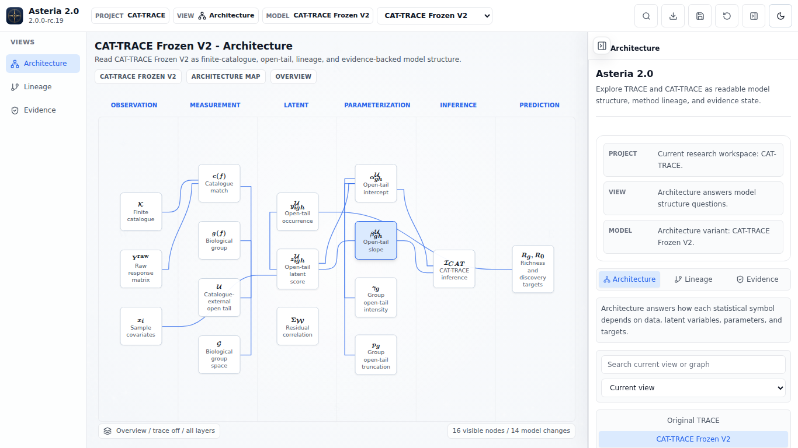

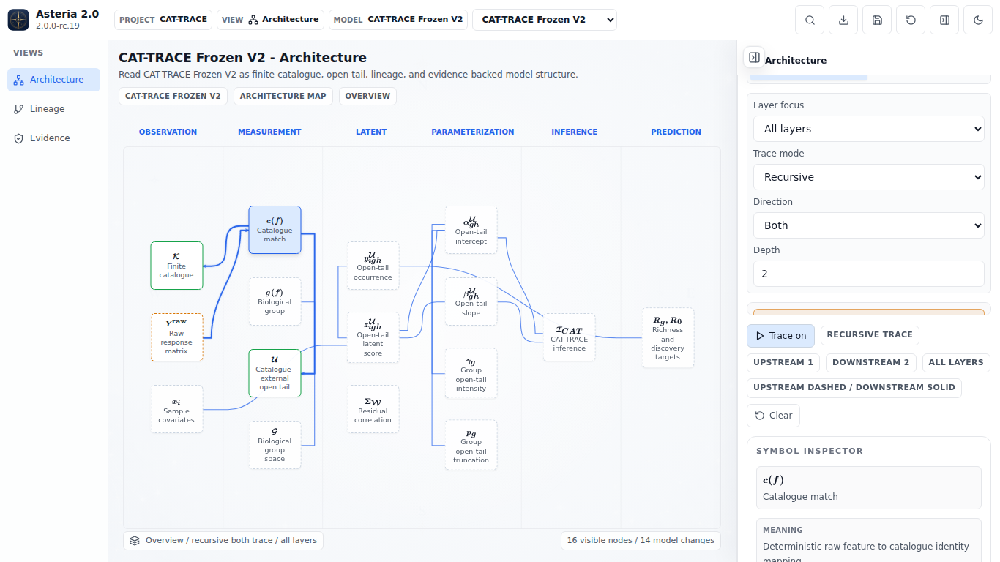

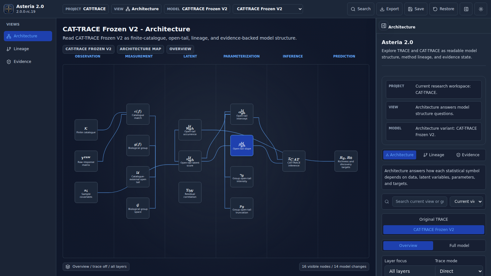

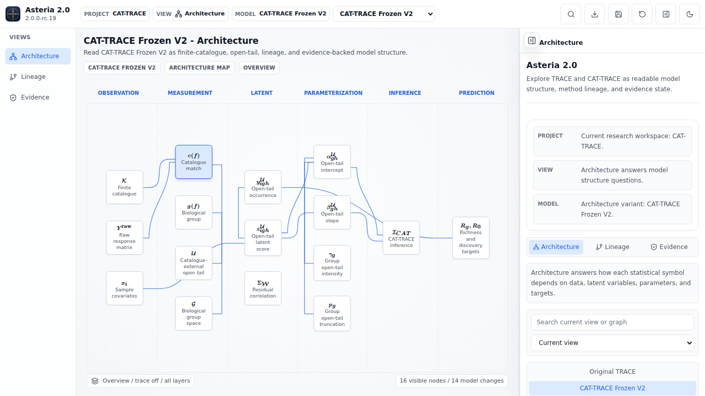

人工观察：1366×768 与 1536×864 下标题、lane、节点和 Inspector 可读；trace OFF 连续选择后布局保持不变，trace ON 的 active/context 层级可辨。但 Overview 的实际路径交叉仍可见，与浏览器 9 对计数一致。

### Full model reset

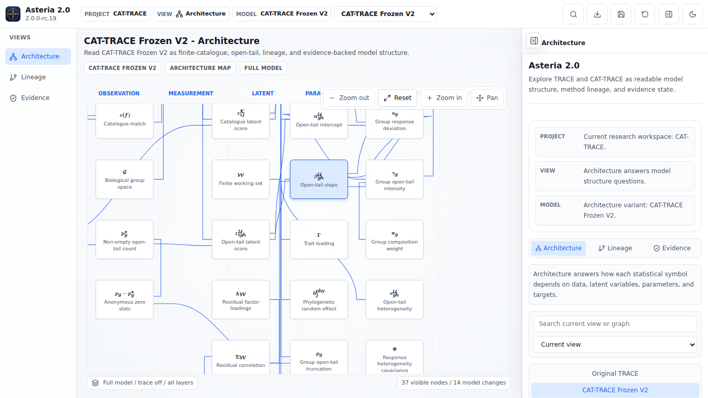

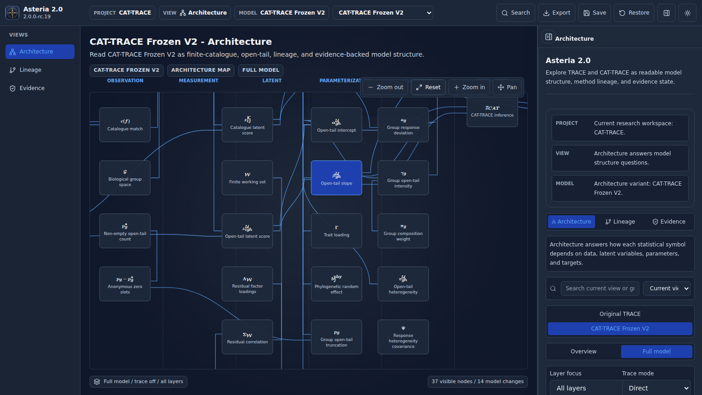

人工观察：Zoom/Reset/Pan 控件可发现，节点主文字未裁切；中央列之间存在密集交叉，尤其 1366 Light 截图中不可忽略，与浏览器 47 对计数一致。

### Original TRACE

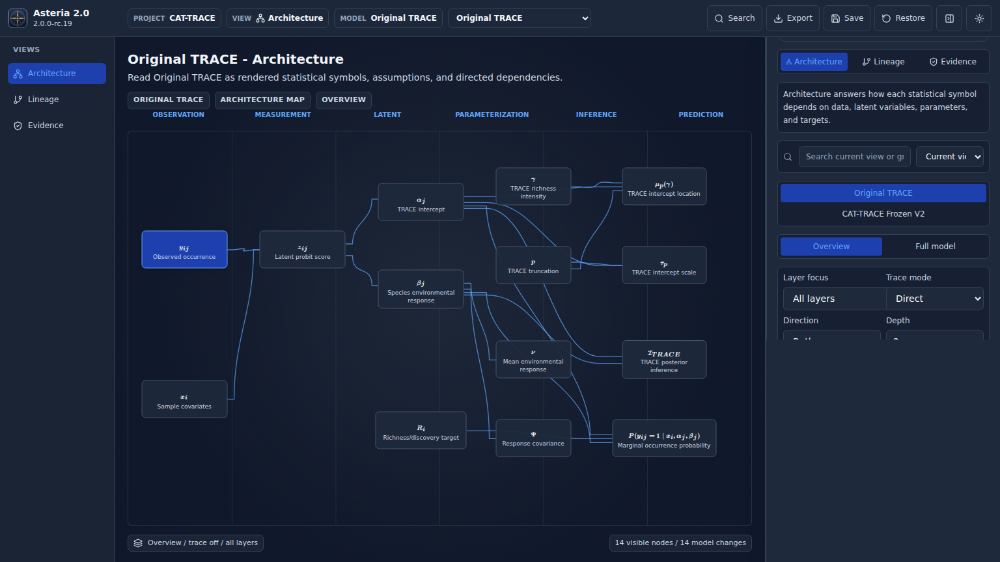

人工观察：Original TRACE 的节点、数学符号和 Inspector 可读；本任务没有把这张图的视觉状态误当作 CAT-TRACE 专项交叉门槛通过，也没有修改其科学语义。

## Evidence

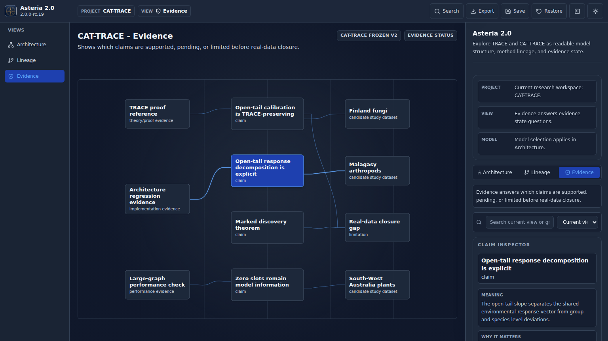

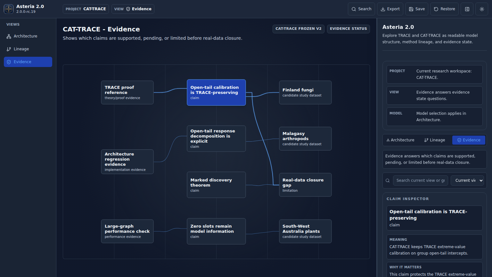

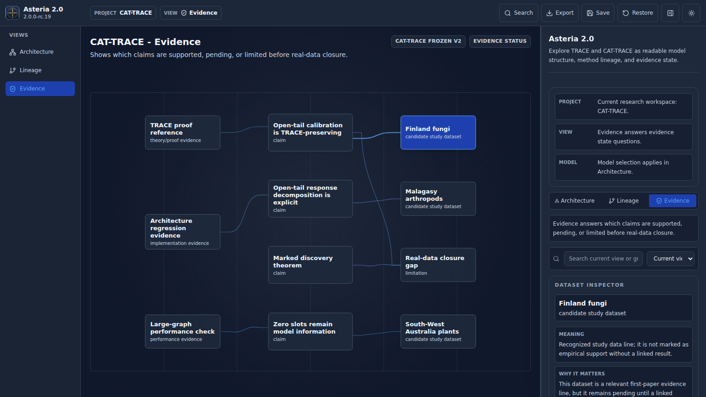

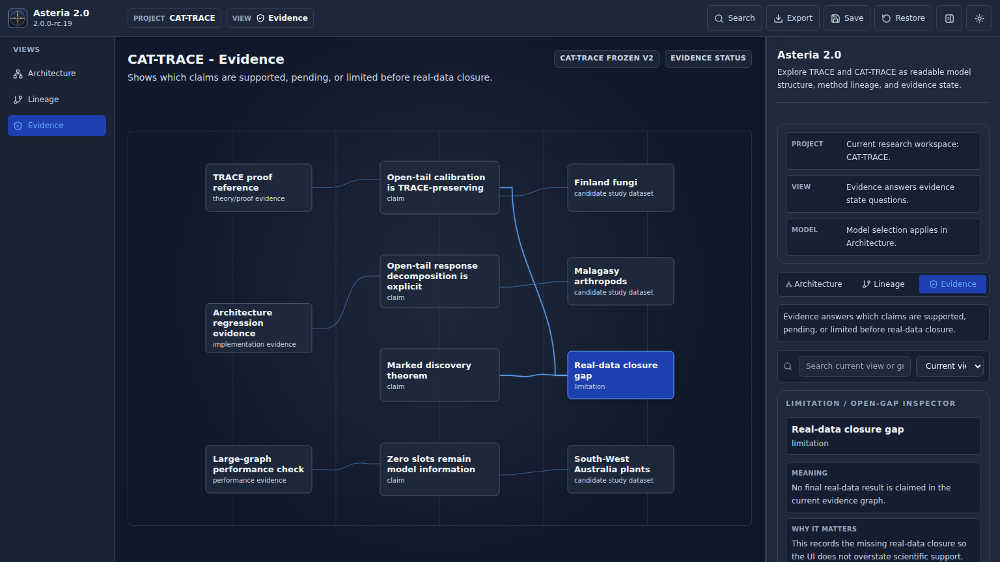

人工观察：Claim、Dataset、Limitation 三类 Inspector 随选择正确切换，文字和主卡片可读。高亮 `Real-data closure gap` 时，向上弯曲的 limitation 路径与 Malagasy 水平路径的交叉最清楚，支持浏览器计数 1。

## Lineage 与通用结构控制

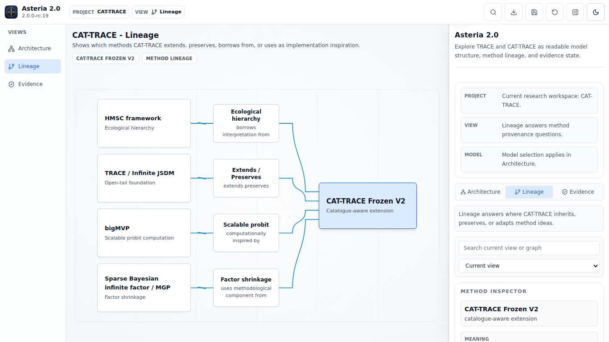

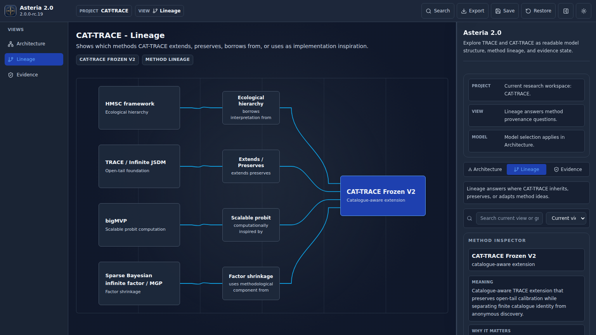

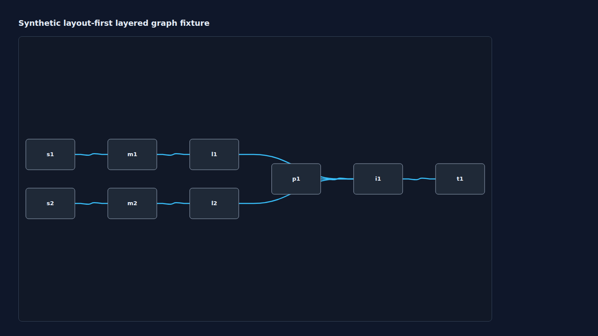

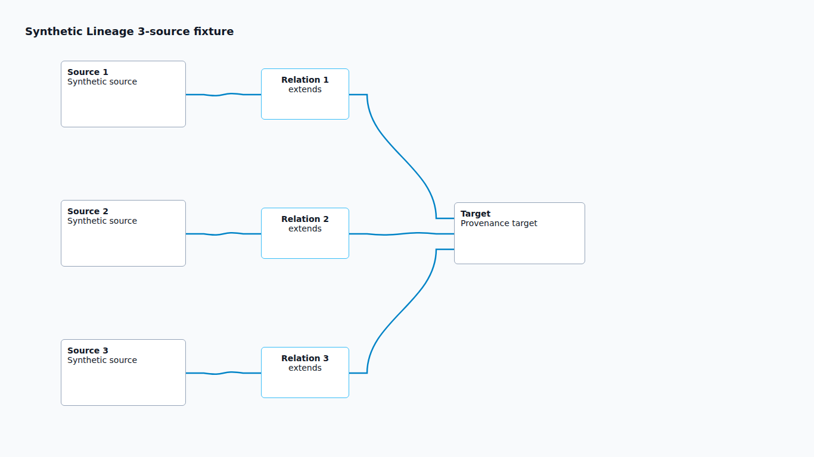

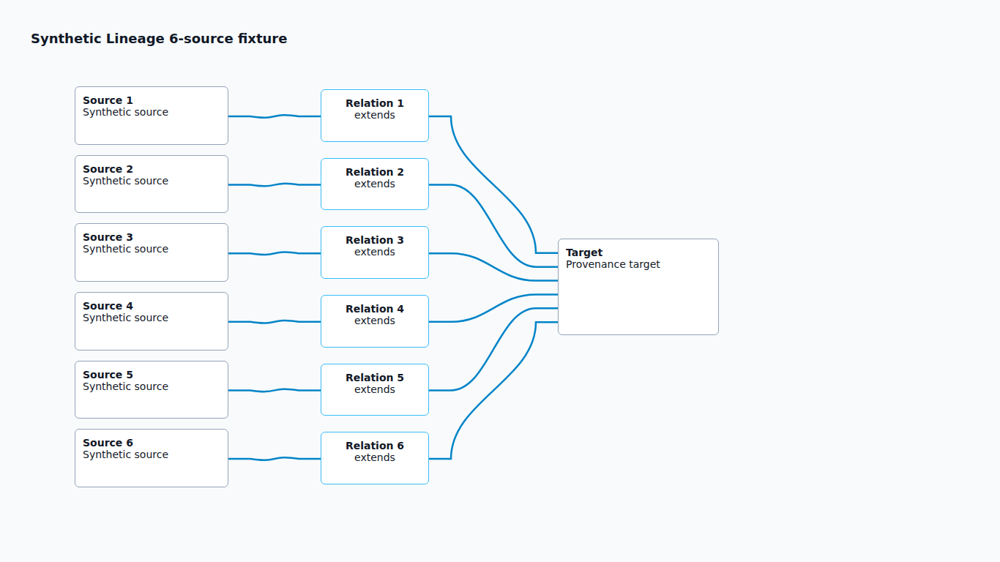

人工观察：Lineage 的 source、relation、target 三列关系稳定，3/6-source fan-in 没有裁切或交叉；通用 layered fixture 也保持零交叉。这些控制说明验收器不是把所有 fan-in、共享端点或稳定 relation column 误判为坏图。

## 身份与边界

- 截图命令：`ASTERIA_SELF_QA_DIR=results/asteria_validator_hardening_20261022/screenshots npm run capture:architecture-rc19`
- 捕获范围：1536×864 / 1366×768、Light/Dark、Architecture Overview/Full reset、CAT/Original TRACE、Lineage、Evidence、Inspector 选择、trace 开/关和通用结构 fixtures。
- 原始测量：`results/asteria_validator_hardening_20261022/validator-run.json`。
- 未修改产品 UI、科学 fixture、部署配置或固定公网地址；截图是本地真实浏览器证据，不代表公网候选或独立审查通过。
